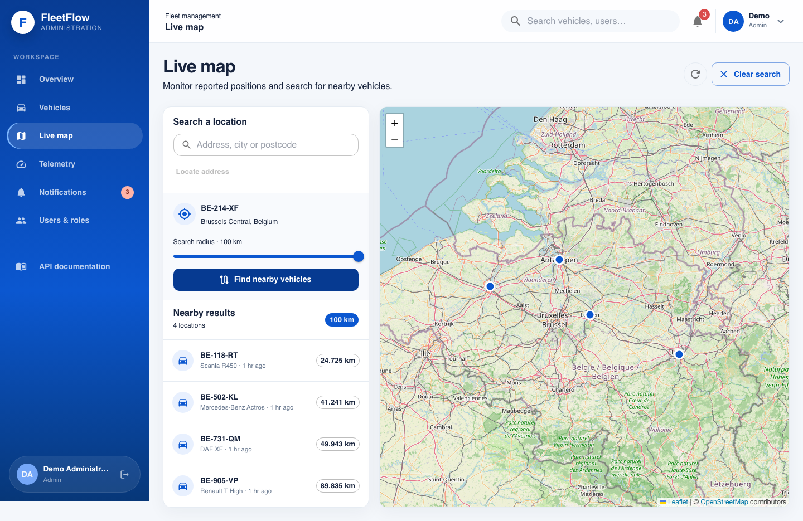
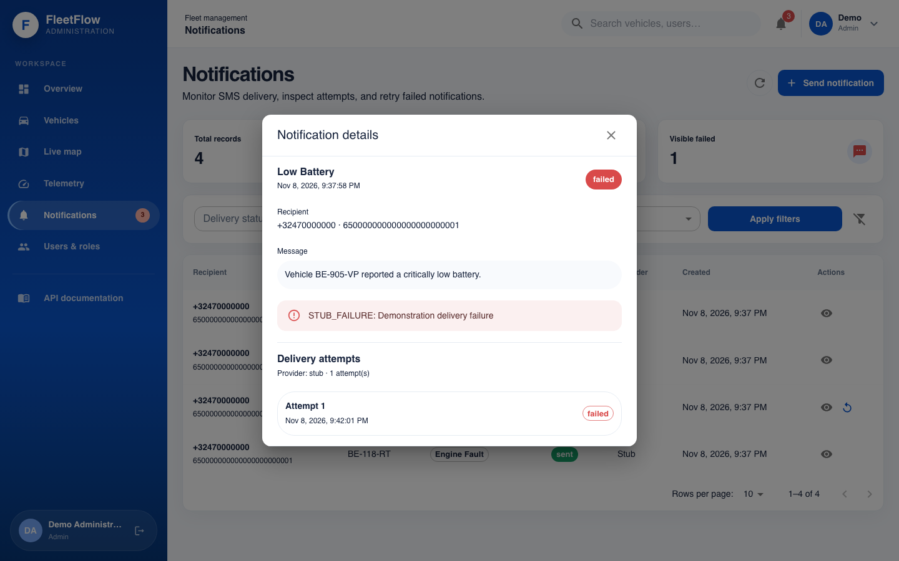
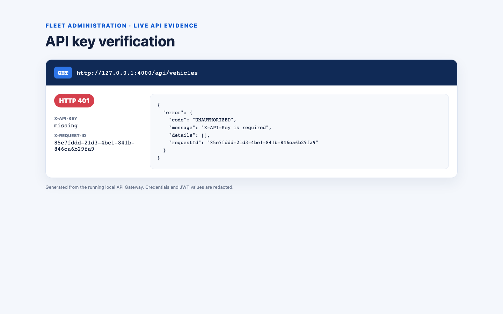
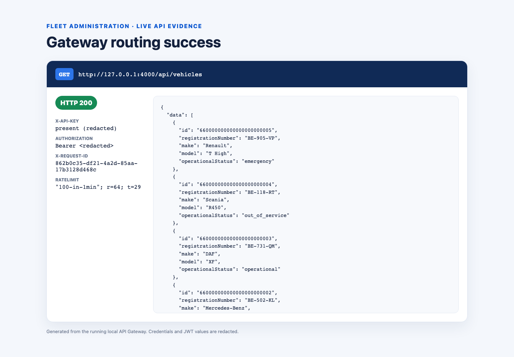
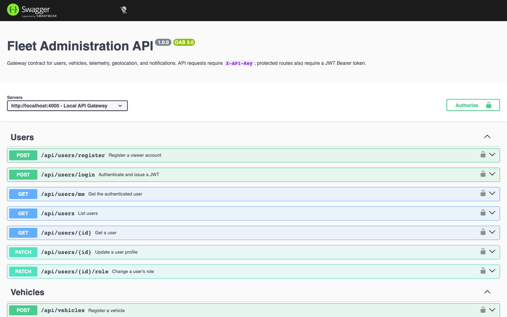

# Demonstration evidence

This folder contains the visual evidence for the main fleet-management flows. If you replace the existing images or add a screencast, keep the result focused on the behavior being demonstrated. Never include JWTs, real API keys, phone numbers, provider credentials, or `.env` contents.

## What to capture

| File | What it should demonstrate |
|---|---|
| `01-map-nearby-vehicles.png` | Map markers, search centre/radius, and nearby result list |
| `02-sms-notification.png` | Critical event or status change and its sent/failed notification record |
| `03-gateway-api-key-rejected.png` | Gateway response when `X-API-Key` is missing or invalid |
| `04-gateway-routing-success.png` | Successful authenticated response routed through port 4000 |
| `05-swagger-ui.png` | Swagger UI showing endpoint models, security, and response documentation |

## A reliable capture sequence

1. Start the seeded stack with `npm run docker:up`.
2. Set the browser to a consistent desktop size such as 1440 × 900.
3. Follow [demonstration.md](../demonstration.md).
4. Capture only the application or terminal region needed to prove the behavior.
5. Add short captions to the submission report stating the action, expected result, and visible evidence.

You can also capture the full set automatically from a running seeded stack:

```sh
npm run demo:capture
```

If you prefer a screencast, cover the same five items in order and place an accessible link in [demonstration.md](../demonstration.md).

## Current evidence

### Geolocation and nearby vehicles

The selected Brussels vehicle returns four nearby vehicles within 100 km, ordered by distance and displayed on the map.



### SMS notification records

The notification screen shows status-change, emergency-stop, low-battery, and engine-fault messages with sent/failed state and a retry action.



### Gateway API-key rejection

The gateway rejects a vehicle request before routing when `X-API-Key` is absent.



### Gateway routing success

An authenticated request through the gateway returns all five seeded vehicle records and pagination metadata.



### Swagger UI

Swagger UI exposes the documented endpoint groups and authorization controls.


